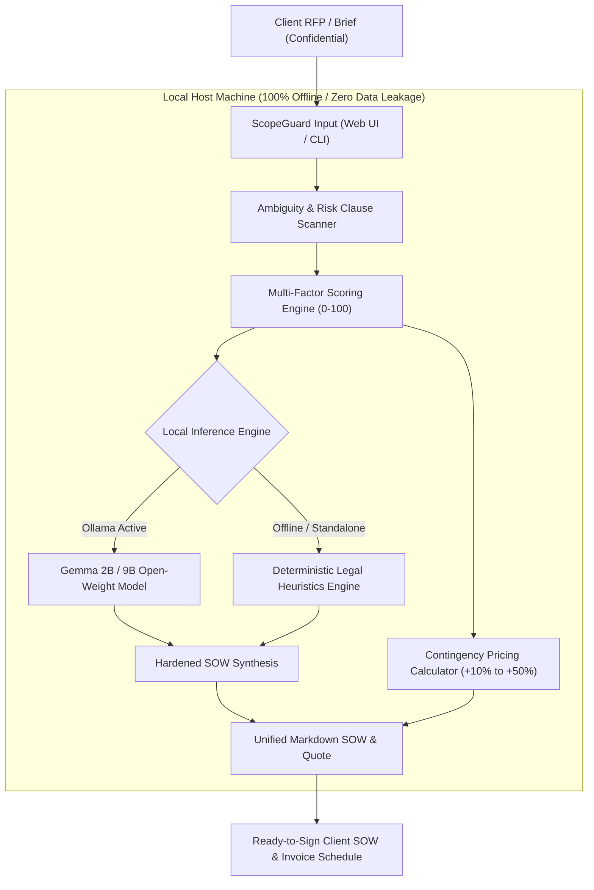

# 🛡️ ScopeGuard AI

> **Local-First AI Proposal & Statement-of-Work (SOW) Risk Auditor for Freelancers & Solo Agencies**  
> *Built with Google Gemma open-weight models for the Hacktoberfest Open-Source AI Challenge: Week 2 (Side Hustle).*

[](https://dev.to/challenges/hacktoberfest-week2-2026-10-12)
[](LICENSE)
[](https://www.python.org/)
[](https://ai.google.dev/gemma)
[](#why-open-innovation-matters)

---

## 📌 Executive Summary & Problem Statement

Independent software engineers, designers, and boutique digital agencies lose an estimated **20% to 35% of billable revenue** to unpaid scope creep, ambiguous deliverable requirements ("*make it blazing fast*"), infinite revision traps, and toxic contract clauses ("*payment upon completion on net-60 terms with unlimited liability*").

At the same time, high-value commercial clients require strict **Non-Disclosure Agreements (NDAs)** and intellectual property covenants. Freelancers **cannot** paste proprietary client RFPs, architecture roadmaps, or confidential project notes into public cloud AI APIs without violating legal covenants.

**ScopeGuard AI** solves both problems simultaneously:
1. **Local-First Privacy Guard:** Runs 100% locally on your machine using **Google's Gemma open-weight models** (via Ollama or standalone heuristic engine). Zero bytes leave your device.
2. **Deterministic Risk & Ambiguity Scoring:** Parses client briefs for 10+ critical scope traps (subjective metrics, open-ended lists, unpaid maintenance liabilities).
3. **Hardened Statement of Work (SOW) Generator:** Converts loose emails and RFPs into an air-tight, line-itemized contractual SOW with explicit out-of-scope boundaries, 2-round revision limits, and change-order safeguards.
4. **Dynamic Risk-Contingency Pricing Calculator:** Recommends mathematically backed pricing buffers (+10% to +50%) and milestone payment schedules (40% / 30% / 30% on Net-15).

---

## 🏗️ System Architecture



---

## 💡 Why Open Innovation Matters for This Side Hustle

The Hacktoberfest Week 2 prompt asks: *Why does open innovation matter for what you built?*

| Closed Proprietary Cloud APIs | ScopeGuard AI with Open-Weight Gemma |
|---|---|
| **Violates Client NDAs:** Pasting proprietary specs sends client IP to third-party servers. | **100% Confidentiality:** All inference executes locally on Apple Silicon / CPU / GPU via Ollama. |
| **Crushing Per-Token API Costs:** Long RFP documents and repeated SOW revisions eat into solo developer profit margins. | **$0 Marginal Inference Cost:** Run thousands of proposal audits with zero API bills. |
| **Vendor Lock-in & Downtime:** Rate limits or sudden policy/price changes break your workflow. | **Sovereign & Future-Proof:** Open weights are permanent, auditable, and run completely offline on planes or client sites. |

---

## 💼 The Side Hustle Business Model

ScopeGuard AI is designed as a high-margin micro-SaaS / downloadable developer utility:

- **Target Audience:** Freelance developers, UX/UI designers, SEO consultants, and solo agency founders.
- **Value Proposition:** Saving just **one** $3,000 freelance project from a 20-hour scope creep spiral delivers an immediate **30x ROI**.
- **Monetization Mechanics:**
  - **Free Open-Source Core (MIT):** Full local CLI, web dashboard, and Gemma integration for individual freelancers.
  - **Pro Lifetime License ($49 one-time):** Pre-built agency contract templates, PDF proposal exporter, and customized milestone branding.
  - **Solo Agency Retainer Tier ($19/month):** Team sharing, client change-order tracking portal.

---

## 🚀 Quick Start (Zero External Dependencies)

ScopeGuard AI is engineered to run out of the box using Python's standard library.

### 1. Clone & Run the Web Dashboard

```bash
git clone https://github.com/AdityaChaudhary5412/scopeguard-ai.git
cd scopeguard-ai

# Launch the zero-dependency local web app:
python3 app.py
```

Open your browser to: **`http://localhost:8000`**

### 2. Optional: Enable Local Gemma Open-Weight Model

To activate deep LLM legal reasoning with Gemma:

```bash
# Install Ollama (https://ollama.ai) and pull Gemma:
ollama run gemma2:2b
```

ScopeGuard AI automatically detects active Ollama endpoints at `localhost:11434` and routes prompt generation to Gemma. If Ollama is not active, ScopeGuard seamlessly transitions to its built-in deterministic heuristic engine.

---

## 💻 CLI Usage

ScopeGuard features a CLI for power users and terminal workflows:

### Audit an RFP File:
```bash
python3 cli.py audit samples/sample_client_rfp.txt
```

### Generate a Hardened SOW with Financial Pricing:
```bash
python3 cli.py sow samples/sample_client_rfp.txt --hours 50 --rate 110 --output hardened_sow.md
```

### Check Gemma Model Status:
```bash
python3 cli.py status
```

---

## 🧪 Automated Test Suite

Run the built-in test suite verifying risk normalization, clause parsing, quote math, and fallback SOW generation:

```bash
python3 -m unittest discover -s tests -v
```

---

## 📜 License

Distributed under the **MIT License**. See [`LICENSE`](LICENSE) for full details.
